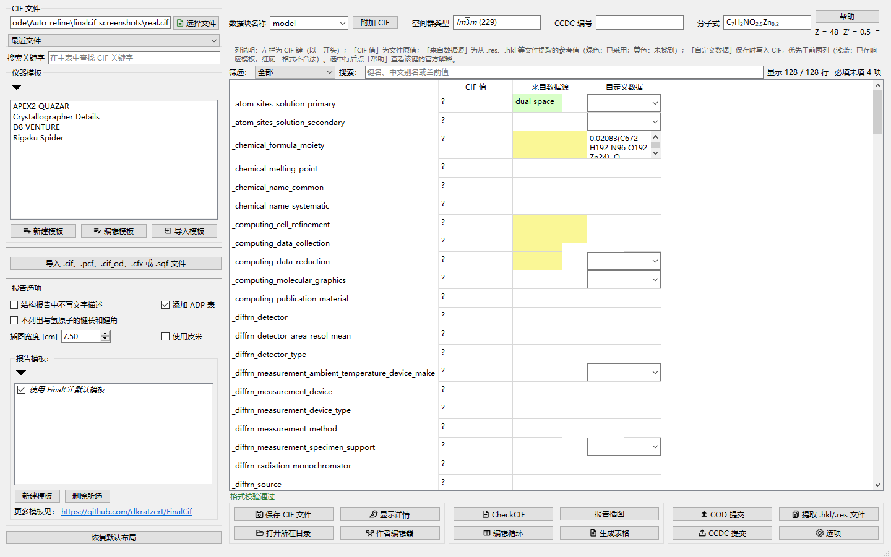
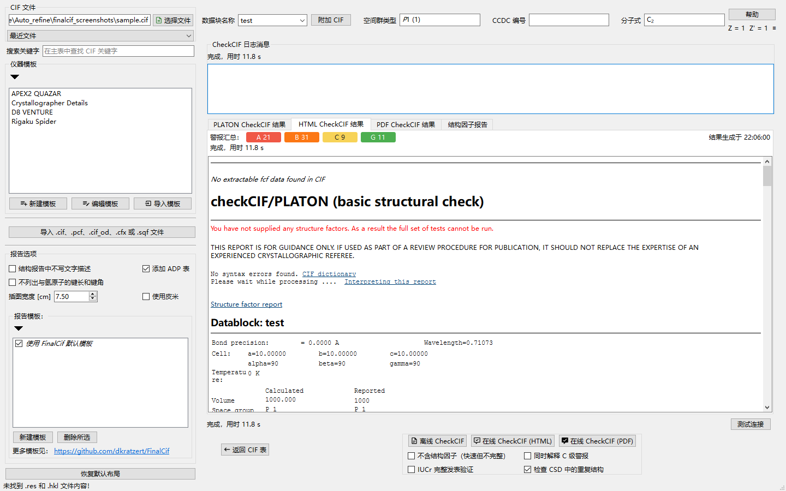
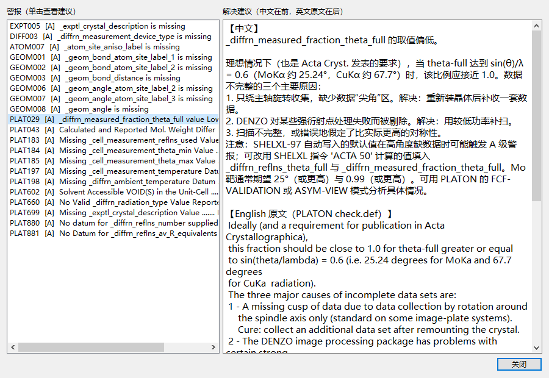

[English](README.en.md) | 简体中文

# FinalCif 中文版

FinalCif 的中文本地化版本，基于 [dkratzert/FinalCif](https://github.com/dkratzert/FinalCif)。

## 下载与安装

在 [Releases](https://github.com/honghaocao838/FinalCif-zh/releases) 下载 `FinalCif-zh-v180-setup-x64.exe`，双击安装。

- 安装到当前用户目录，不需要管理员权限
- 安装包未签名；SmartScreen 提示“无法识别的应用”时，选择“更多信息 → 仍要运行”即可
- 下载后可用 Release 中的 `SHA256SUMS.txt` 校验文件
- 支持 Windows 10/11 x64
- 安装向导与程序界面均为中文
- 安装后可直接打开 `.cif`、`.res`、`.hkl` 文件，或拖到窗口上

## 从旧版升级

2026-11-26 之前的版本会把 `_audit_creation_method` 写成中文。关闭程序后安装新版即可；已经生成的 CIF 用新版打开并保存一次会改回英文，批量处理可用 [`fix_audit_creation_method.py`](installer/fix_audit_creation_method.py)。

## FinalCIF 是什么

FinalCIF 是一个 CIF 文件编辑器，用于把单晶 X 射线衍射实验的数据整理成完整的 CIF 文件。

- 从 SHELX、SADABS 等文件自动收集晶胞、空间群、数据完整度、R 值等信息
- 表格化编辑 CIF 项，支持模板与数据来源对照
- 内置 CheckCIF（离线 PLATON 或在线 IUCr），PLAT 警报可查看解释
- 生成结构报告（Word/HTML）、ADP 表、分子图
- 支持 PLATON SQUEEZE / Olex2 溶剂掩蔽、孪晶、绝对构型等常见处理

本项目在此基础上有以下改动：

- 界面、提示、对话框全部中文
- 主表上方有列说明，列标题与 CIF 键有悬停提示
- 主表支持按状态、中文别名、必填项和 CheckCIF 提及项过滤，并汇总格式校验错误
- 在线 CheckCIF 显示等待时长、失败原因与警报摘要，可取消请求并测试服务器连接；运行前自动检查必填项缺失并跳到对应行
- CheckCIF 的 PLAT 警报全部 545 条附中文解释，并附官方英文原文；IUCr CIF 预检项（prefilter）附中文规则与修复建议
- CIF 字典帮助全部中文
- 关闭了上游自动更新，更新通过本仓库的 Releases 发布
- 生成的 CIF 内容与报告正文保持英文

## 界面截图

主界面：

CheckCIF 警报汇总（A/B/C/G 分级）：

警报解释：

## 许可与致谢

- 原版 FinalCif：Daniel Kratzert，Beer-Ware（Revision 42），见 [LICENSE](LICENSE)
- 中文汉化：Honghao Cao，同样以 Beer-Ware 发布
- 第三方组件（PLATON、fastmolwidget、PySide6）：见 [THIRD_PARTY_NOTICES.md](THIRD_PARTY_NOTICES.md)

## 联系

Honghao Cao，honghaocao838@gmail.com。问题请发邮件或在仓库开 Issue。

## 原仓库

https://github.com/dkratzert/FinalCif
